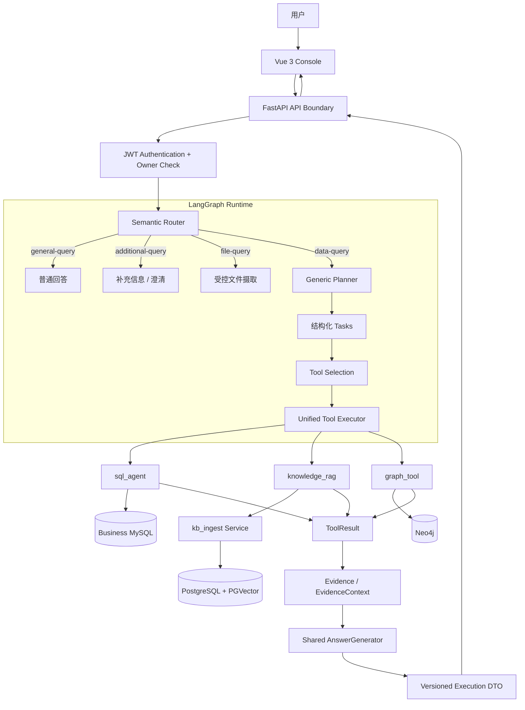

# Multi-Source Data Agent

**面向企业分析场景的多源数据 Agent**：基于 FastAPI + LangGraph，将结构化数据查询、知识检索和图关系查询统一到一条可追踪的执行链路中。用户通过自然语言提问，系统完成语义路由、任务规划、工具选择、数据访问、证据聚合和答案生成，并在 Vue 控制台展示 SQL / Cypher、来源证据、引用与执行状态。

> **项目定位**：重点展示多源 Agent 的工程化设计：统一工具契约、Evidence Lineage、Text2SQL 安全边界、RAG 检索链路和可观测执行结果，而不是单纯展示模型问答。

**Stack:** Python 3.10–3.12 · FastAPI · LangGraph · MySQL · PostgreSQL / PGVector · Neo4j · Vue 3 / TypeScript · Docker Compose

**License:** [Apache-2.0](LICENSE)

[真实演示](docs/SHOWCASE.md) · [系统架构](docs/ARCHITECTURE.md) · [技术亮点](docs/TECHNICAL_HIGHLIGHTS.md) · [关键设计决策](docs/DESIGN_DECISIONS.md) · [快速启动](docs/QUICK_START.md) · [安全验证记录](docs/SECURITY_RELEASE.md)

------------------------------------------------------------------------

## 为什么做这个项目

企业数据通常分散在不同形态的数据系统中：

- 订单、销量和业务明细位于关系型数据库；
- 政策、SOP 和业务文档位于知识库；
- 商品、供应商和品类之间的关系位于图数据库。

单一 SQL、RAG 或 Graph 查询都无法自然覆盖跨来源问题。这个项目将三种数据访问能力封装为统一工具，由 Agent 根据任务选择数据源，并将结果转换为可追溯的 Evidence，再统一生成回答。

默认演示场景为 **Synthetic Enterprise Retail**。订单与销量使用 MySQL，政策文档使用 PostgreSQL / PGVector，商品关系使用 Neo4j。演示数据均为合成数据，不包含真实企业数据。

## 系统架构



核心链路：

``` text
Request
→ Semantic Router
→ Generic Planner
→ Tool Selection
→ Unified Tool Executor
→ ToolResult
→ Evidence
→ EvidenceContext
→ AnswerGenerator
→ Execution DTO
→ Vue Console
```

Router 决定请求属于哪一种产品处理路线；Planner 将数据问题拆成结构化任务；Tool Selection 为每个任务选择 SQL、RAG 或 Graph 工具。三个工具通过统一执行边界返回结果，不把底层数据库、HTTP client 或检索策略泄漏给上层。

README 仅保留系统总览图；完整请求时序、数据工具细节和安全边界图见 [ARCHITECTURE.md](docs/ARCHITECTURE.md)，避免在多个文件中重复维护同一张图。

## 核心能力

| 能力             | 实现方式                                                                                                    | 工程价值                                   |
|:-----------------|:------------------------------------------------------------------------------------------------------------|:-------------------------------------------|
| 多源任务编排     | Semantic Router、Generic Planner、Tool Selection                                                            | 将产品路由、任务拆解和数据源选择分离       |
| 统一工具执行     | 三个 canonical tools + `ToolResult`                                                                         | 上层不依赖各工具内部实现                   |
| Text2SQL         | Schema Retrieval、SQLGlot AST 校验、只读数据库权限、Schema / Table 白名单、LIMIT、timeout、最多一次受控修复 | 将模型生成与实际执行权限分开               |
| Knowledge RAG    | PGVector 召回、domain / dataset 过滤、服务端 rerank；可选 Hybrid + RRF                                      | 保留来源身份和检索可解释性                 |
| Graph Query      | 预定义 Cypher 与动态 Text2Cypher 策略统一封装                                                               | 在模板覆盖率和动态查询能力之间取得平衡     |
| Evidence Lineage | `ToolResult → Evidence → EvidenceContext → citation_ids`                                                    | 回答可关联到 SQL 行、文档片段和图记录      |
| 可观测执行       | Trace、阶段耗时、状态分类、版本化 Execution DTO                                                             | 能区分路由、工具执行、证据和回答阶段的问题 |
| 安全边界         | APP / BUSINESS 数据库分离、JWT owner 校验、内部服务令牌、受控 `file_id`                                     | 减少 Agent 跨越应用数据边界的风险          |

## 真实演示

以下为 **2026-10-23** 从真实 Vue 页面提交的三条独立请求，使用合成 Enterprise Retail 数据。耗时是当次本地前端观测值，不是生产 SLA 或 Benchmark 成绩。

| 场景              | 当次结果                                                                  | 前端观测耗时 | 证据                                                                                                                                    |
|:------------------|:--------------------------------------------------------------------------|:------------:|:----------------------------------------------------------------------------------------------------------------------------------------|
| SQL：订单统计     | `retail_orders` 共 12 个订单；返回 SQL 与 MySQL Evidence                  |    26.9 s    | [回答截图](docs/assets/query-sql-answer.png) · [Evidence](docs/assets/query-sql-evidence.png) · [录屏](docs/assets/demo-sql.webm)       |
| Graph：供应商关系 | Aurora ANC Headphones 由 NorthStar Electronics 供货；返回 Cypher 与图记录 |    13.5 s    | [回答截图](docs/assets/query-graph-answer.png) · [Evidence](docs/assets/query-graph-evidence.png) · [录屏](docs/assets/demo-graph.webm) |
| RAG：退货政策     | 电子产品非质量问题退货期限为 7 个自然日；返回政策来源与引用               |    22.4 s    | [回答截图](docs/assets/query-rag-answer.png) · [Evidence](docs/assets/query-rag-evidence.png) · [录屏](docs/assets/demo-rag.webm)       |

[完整演示说明](docs/SHOWCASE.md)包含提问截图、回答截图、Evidence 面板和未剪辑操作录屏。

## 关键工程设计

### 1. 路由与工具选择分离

顶层 Router 只判断 `general-query`、`additional-query`、`data-query` 和 `file-query`。进入 `data-query` 后，再由 Planner 拆解任务，由 Tool Selection 在 `sql_agent`、`knowledge_rag` 和 `graph_tool` 中选择。

这样可以避免产品入口直接绑定某个数据源，也便于后续替换单个工具实现。

### 2. 统一工具契约与证据链

三个工具统一返回 `ToolResult`，其中区分 `success`、`empty` 和 `error`。可引用事实独立表示为 `Evidence`，包含来源、来源 ID、任务 ID、排序和检索分数等元数据。

共享 AnswerGenerator 消费 EvidenceContext，而不是把各工具的自然语言答案简单拼接。HTTP 层再将内部结果转换为有字段白名单和大小限制的 `ExecutionDTO`，不直接暴露完整 LangGraph State。

### 3. Text2SQL 采用纵深防御

SQL 生成结果只是候选语句，不代表允许执行。执行前经过 SQLGlot AST 与只读策略校验、Schema / Table 白名单和字段检查；数据库连接使用独立业务库只读账号，并检查实际 grants。查询还有行数上限、数据库 timeout 和最多一次重新校验后的受控修复。

### 4. RAG 将检索与回答评估分开

默认知识检索后端为 PGVector，reranking 由 `kb_ingest` 服务负责，避免应用层重复重排。Hybrid Retrieval 是可选模式：向量与 PostgreSQL 全文候选通过 RRF 融合，再统一 rerank。检索命中不等于最终回答正确，因此检索指标与完整 Agent HTTP 指标分开统计。

### 5. 安全边界不依赖 Prompt

应用持久化与业务查询使用不同数据库连接；SQL 工具只获得显式业务 Schema / Table 范围内的只读权限。Chat、Session、History、Upload 使用短期 JWT 的签名 `sub` 做身份与 owner 校验；知识服务通过独立内部令牌访问。客户端不能通过请求体覆盖用户身份或直接指定服务器任意路径。

## 验证记录

以下是基于 packaging baseline `7c1d574` 的发布验证快照，详细命令和限制见 [SECURITY_RELEASE.md](docs/SECURITY_RELEASE.md)。

| 验证项                          | 记录结果                                                                               |
|:--------------------------------|:---------------------------------------------------------------------------------------|
| Python 3.10                     | 394 passed，0 failed，0 skipped                                                        |
| Python 3.12                     | 394 passed，0 failed，0 skipped                                                        |
| 新增安全测试                    | 77 项                                                                                  |
| 定向 Black / mypy               | 通过                                                                                   |
| Wheel 构建、安装及隔离导入      | 通过                                                                                   |
| 前端 `npm ci` / lint / build    | 通过                                                                                   |
| npm audit                       | 0 漏洞                                                                                 |
| Docker 镜像构建与五服务隔离验证 | 通过，见安全整改记录                                                                   |
| GitHub Actions                  | [运行记录](https://github.com/YingliaoO/langgraph-data-agent/actions/runs/42011295876) |

确定性测试使用隔离环境、真实 JWT 验证和 Mock 工具调用，不等于真实模型端到端质量验证。本轮未执行需要付费 LLM、Embedding 和 Reranker 服务的完整问答 Smoke。

## 快速启动

需要 Docker Compose、Python 3.10–3.12（推荐 3.12）；前端需要 Node.js 22 / npm。模型、Embedding 和 Reranker 服务需自行配置，调用可能产生费用。

``` powershell
# Windows PowerShell，在仓库根目录执行
python -m venv .venv
.\.venv\Scripts\Activate.ps1
python -m pip install -r requirements.txt
python -m pip check
Copy-Item .env.example .env
```

编辑 `.env`，填写有效的模型服务配置、`APP_DATABASE_URL`、只读 `BUSINESS_DATABASE_URL`，并分别生成至少 32 字节的 `AUTH_JWT_SECRET` 和 `KNOWLEDGE_SERVICE_TOKEN`。不要提交真实 `.env`。

``` powershell
docker compose up -d --build
curl.exe http://localhost:8000/ready

# 为本地演示签发短期 Bearer token
$env:MULTISOURCE_AGENT_ACCESS_TOKEN = python scripts/create_access_token.py --subject demo-operator

# 初始化合成数据（会写入 MySQL、Neo4j 和 PGVector）
python .\demo\enterprise_retail\bootstrap.py
python -u .\demo\enterprise_retail\smoke.py

# 另开终端启动 Vue
cd web
npm ci
npm run dev
```

在 Vue 控制台输入短期 Bearer token 后即可提问。Linux/macOS 的安装与启动命令、数据库账号准备和部署升级见 [QUICK_START.md](docs/QUICK_START.md) 与 [DEPLOYMENT.md](docs/DEPLOYMENT.md)。

**安全提示：**默认 Compose 面向本机隔离演示，包含开发便利配置，不应直接暴露公网。生产部署必须按 [DEPLOYMENT.md](docs/DEPLOYMENT.md) 使用安全覆盖配置、独立数据库账号、可信身份签发、HTTPS 和密钥管理。

## 已知边界

- Planner 当前支持独立子任务并行和 Evidence 聚合；`depends_on` 是任务描述字段，不是前序结果驱动后续输入的完整 DAG scheduler。
- LangGraph checkpoint 使用进程内 `MemorySaver`；聊天历史单独持久化，不代表可以恢复完整 Graph State。
- JWT 提供最小身份验证和对象 owner 隔离，不是完整用户管理或 RBAC；尚无业务数据租户级 / 行级权限。
- 文件上传返回摄取任务提交结果；后台处理完成和可检索状态需要另行确认。
- 未执行真实付费模型端到端 Smoke；公开仓库不分发内部 Benchmark 数据集、专项语料或实验报告。

详细边界见 [KNOWN_LIMITATIONS.md](docs/KNOWN_LIMITATIONS.md)。

## 文档导航

| 文档                                                          | 内容                                 |
|:--------------------------------------------------------------|:-------------------------------------|
| [ARCHITECTURE.md](docs/ARCHITECTURE.md)                       | 系统分层、执行链路、数据流和安全边界 |
| [TECHNICAL_HIGHLIGHTS.md](docs/TECHNICAL_HIGHLIGHTS.md)       | 可展示的技术亮点、代码入口和证据     |
| [DESIGN_DECISIONS.md](docs/DESIGN_DECISIONS.md)               | 关键设计决策、取舍与未实现边界       |
| [SECURITY_RELEASE.md](docs/SECURITY_RELEASE.md)               | P0/P1 整改和发布验证                 |
| [API_CONTRACT.md](docs/API_CONTRACT.md)                       | HTTP Execution 契约                  |
| [TEXT2SQL_IMPLEMENTATION.md](docs/TEXT2SQL_IMPLEMENTATION.md) | SQL Agent 实现                       |
| [RAG_EVALUATION.md](docs/RAG_EVALUATION.md)                   | RAG 检索评估方法                     |
| [EVALUATION.md](docs/EVALUATION.md)                           | Agent 与检索评测口径                 |
| [SHOWCASE.md](docs/SHOWCASE.md)                               | 真实前端演示证据                     |
| [KNOWN_LIMITATIONS.md](docs/KNOWN_LIMITATIONS.md)             | 当前运行边界                         |

## 目录结构

``` text
multisource_data_agent/   FastAPI、LangGraph、Router / Planner / Tools、Evidence
kb_ingest/                文档摄取、Embedding、PGVector 检索与 Reranker
web/                      Vue 3 / TypeScript 控制台
demo/enterprise_retail/   合成零售数据、初始化和 Smoke
tests/                    确定性工程与安全回归测试
eval/                     Agent / RAG 评测 Runner 与评分器
docs/                     架构、设计决策、部署、评测和演示文档
```

## 许可证

本项目采用 [Apache License 2.0](LICENSE)。第三方组件及数据来源见 [THIRD_PARTY_NOTICES.md](THIRD_PARTY_NOTICES.md)。
