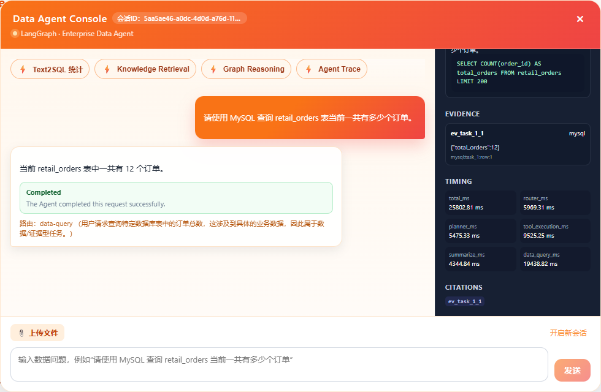
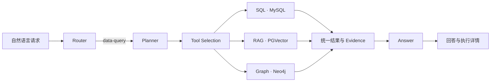

# Multi-Source Data Agent

基于 **FastAPI + LangGraph** 的多源数据分析 Agent。通过自然语言查询 MySQL 业务数据、PGVector 政策文档和 Neo4j 实体关系，在 Vue 控制台查看回答、SQL/Cypher、来源证据与执行过程。

**Python 3.10–3.12 · Vue 3 · Docker Compose · [Apache 2.0](LICENSE)**

[快速开始](#快速开始) · [真实演示](docs/SHOWCASE.md) · [架构设计](docs/ARCHITECTURE.md) · [评测方法](docs/EVALUATION.md) · [API](docs/API_CONTRACT.md)

发布配置与当前验证范围见[安全整改记录](docs/SECURITY_RELEASE.md)。Chat/Session/Upload 需要短期 Bearer token；业务 SQL 使用独立只读账户。

默认场景为 **Synthetic Enterprise Retail**：订单与销量放在 MySQL，政策与 SOP 放在 PGVector，商品关系放在 Neo4j。全部业务数据均为合成数据，用于展示异构数据访问与统一编排。

## 真实查询演示



2026-10-23 从真实 Vue 页面提交并录制。以下为三条独立请求，均返回执行结果和来源引用：

| 提问 | 当次实际结果 | 查看 |
| --- | --- | --- |
| 当前有多少个订单？ | 12 个订单，返回 SQL 与 MySQL Evidence | [回答](docs/assets/query-sql-answer.png) · [原始录屏](docs/assets/demo-sql.webm) |
| Aurora ANC Headphones 由谁供货？ | NorthStar Electronics，返回 Cypher 与图记录 | [证据](docs/assets/query-graph-evidence.png) · [原始录屏](docs/assets/demo-graph.webm) |
| 电子产品无质量问题，多久可以退货？ | 7 个自然日，返回政策原文来源与引用 | [证据](docs/assets/query-rag-evidence.png) · [原始录屏](docs/assets/demo-rag.webm) |

[完整截图与操作说明](docs/SHOWCASE.md)记录了真实等待时间；WebM 可下载播放。演示请求与完整评测分别记录。

## 核心实现



| 能力 | 实现要点 |
| --- | --- |
| **任务编排** | 语义路由、结构化任务与三工具选择；独立子任务并行，统一汇总多源证据 |
| **Text2SQL** | Schema 检索增强；SQLGlot 语法、表字段与歧义校验；只读、行数与执行预算限制，最多一次受控修复 |
| **RAG** | PGVector 召回与服务端重排；知识域过滤、稳定身份去重、政策原文分块、版本与显式日期过滤 |
| **Graph** | 预定义 Cypher 与动态 Text2Cypher，查询商品、供应商、品类及活动关系 |
| **结果可追溯** | 版本化 HTTP `execution` 统一任务、工具状态、结果预览、Evidence、引用及阶段耗时 |

普通对话、澄清与 CSV/Excel 摄取使用相应请求路径。三种数据工具的公共边界保持一致，检索策略与图查询策略留在工具内部。更多设计取舍见[架构说明](docs/ARCHITECTURE.md)、[Text2SQL](docs/TEXT2SQL_IMPLEMENTATION.md)和[RAG](docs/RAG_EVALUATION.md)。

## 快速开始

默认 Compose 是仅绑定本机的开发演示配置，保留热重载和演示口令；不要直接用于公网。生产部署使用[安全覆盖配置](docs/DEPLOYMENT.md#生产部署覆盖模板)，并在认证网关后运行。DEBUG 默认关闭。

需要 Docker Compose、Python 3.10–3.12（推荐 3.12）；前端需要 Node.js/npm。请自行配置有效的 LLM、Embedding 和 Reranker 服务，调用可能产生费用。

```powershell
# Windows PowerShell，在仓库根目录执行
python -m venv .venv
.\.venv\Scripts\Activate.ps1
python -m pip install -r requirements.txt
python -m pip check
Copy-Item .env.example .env
# 编辑 .env，填写模型、独立应用/业务数据库配置，并分别生成 AUTH_JWT_SECRET / KNOWLEDGE_SERVICE_TOKEN（至少 32 随机字节）
docker compose up -d --build
curl.exe http://localhost:8000/ready
# 首次使用隔离的演示环境；该步骤会写入合成数据
$env:MULTISOURCE_AGENT_ACCESS_TOKEN = python scripts/create_access_token.py --subject demo-operator
python .\demo\enterprise_retail\bootstrap.py
python -u .\demo\enterprise_retail\smoke.py
```

Vue 控制台单独启动，打开后输入管理员离线签发的短期 Bearer token（仅保存在页面内存）：

```powershell
cd web
npm ci
npm run dev
```

Linux/macOS 使用 `source .venv/bin/activate` 和 `cp .env.example .env`。默认启动 backend、mysql、neo4j、kb_postgres、kb_ingest 五个服务。完整安装、Chat 请求及配置升级见[快速启动](docs/QUICK_START.md)和[部署说明](docs/DEPLOYMENT.md)；本地 OpenAPI 为 `http://localhost:8000/docs`。

Compose 默认绑定本机端口，固定数据库口令及 Neo4j 鉴权设置用于隔离演示环境。部署前请阅读[运行边界](docs/KNOWN_LIMITATIONS.md)，不要直接暴露公网或提交真实 `.env`。

## 示例问题

- 按商品品类统计销售件数，并按销量从高到低排序。
- Aurora ANC Headphones 由哪个供应商供货？
- 电子产品无质量问题的情况下，多少天内可以申请退货？
- 退款率超过 15% 后应该执行什么处理流程？
- 当前有多少个订单？同时说明电子产品非质量问题退货期限。

固定表、关系和政策事实见[合成数据说明](docs/ENTERPRISE_RETAIL_DEMO.md)。最后一个问题展示独立 SQL＋RAG 子任务的汇总。

## 测试与评测

```powershell
python -m pytest -q
```

[CI](.github/workflows/ci.yml)检查 Python 兼容环境、依赖、wheel、前端 lint/build 与 Compose。确定性测试验证契约和安全边界，外部模型行为需要真实服务测量。

评测分完整 Chat HTTP 与 RAG 检索对照：前者检查路由、工具执行、Evidence、回答和耗时；后者比较向量召回、重排与可选混合检索。状态、失败、回退和不同指标分母分别统计，HTTP 正常不等于回答正确。

公开仓库提供通用 Runner、评分器和方法，使用者可准备自己的 JSONL 与源事实。内部 Benchmark、实验报告及运行档案不随仓库分发。参见[评测方法](docs/EVALUATION.md)、[RAG 方法](docs/RAG_EVALUATION.md)和[运行入口](eval/README.md)。

## 使用范围

当前支持独立子任务并行与证据聚合；文件摄取返回后台提交确认，LangGraph checkpoint 使用进程内存。API 使用 JWT 身份与 Session owner 隔离，SQL 使用独立只读账户；完整 RBAC、业务数据租户权限及多实例恢复需额外实现。具体行为见[运行边界](docs/KNOWN_LIMITATIONS.md)。

## 代码入口与文档

| 目录 | 内容 |
| --- | --- |
| `multisource_data_agent/` | FastAPI、LangGraph、Text2SQL、三工具与证据契约 |
| `kb_ingest/` | 摄取、Embedding、PGVector、检索与重排 |
| `web/` | Vue 3 / TypeScript 控制台 |
| `tests/`、`eval/` | 确定性回归、评测集、评分器与结果摘要 |
| `demo/enterprise_retail/` | 合成数据、初始化与 Smoke |

进一步阅读：[文档索引](docs/README.md) · [API 契约](docs/API_CONTRACT.md) · [开发说明](docs/README_DEV.md)。

## 许可证

采用 [Apache License 2.0](LICENSE)。第三方组件及数据来源见[归属说明](THIRD_PARTY_NOTICES.md)。APOC 经官方 Neo4j 镜像插件配置加载，仓库不分发 JAR；历史 Recipe 数据与未确认授权的资产不随公开仓库分发。
